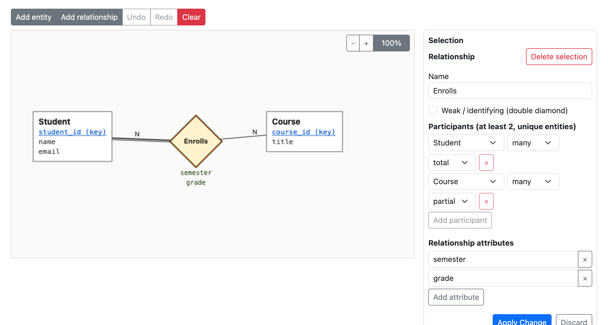
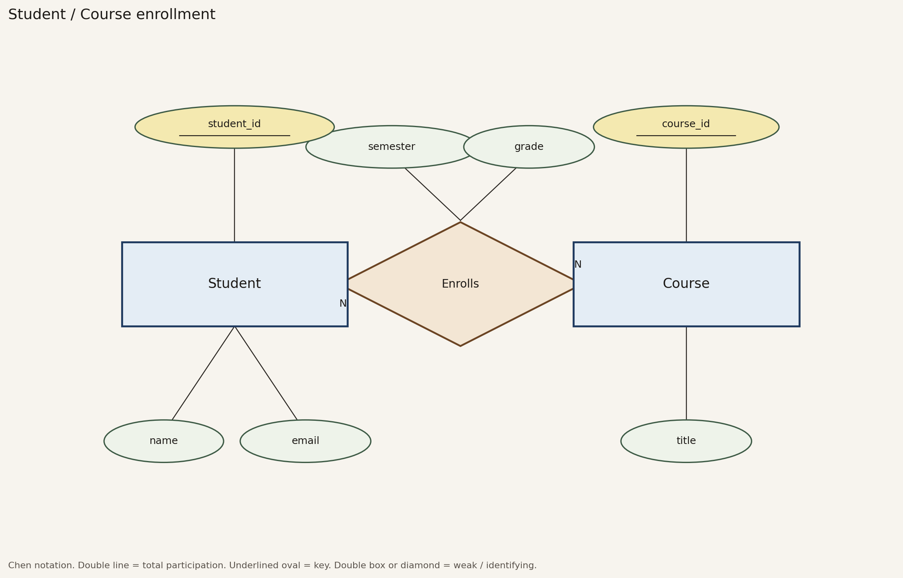

# pl-er-diagram-builder

An open-source [PrairieLearn](https://github.com/PrairieLearn/PrairieLearn) element for drawing and auto-grading Chen-style entity-relationship diagrams. Students build the diagram on a canvas (or edit JSON); the server grades the semantic schema with partial credit and ignores layout.



*The element itself, rendered from the real controller, template, JS, and CSS in headless Chrome by `scripts/render_element.py screenshot`.*

## Features

- Canvas editing: add, drag, rename, and delete entities and relationships; double-click empty canvas to add an entity.
- Selection inspector: names, key and descriptive attributes, weak flags, participants, cardinality (`one` / `many`), participation (`total` / `partial`), with Apply / Discard.
- Binary, ternary, and higher relationships; weak entities (double box) and identifying relationships (double diamond).
- Undo / redo (toolbar or Ctrl+Z / Ctrl+Shift+Z), zoom, and an optional JSON view.
- Starter diagrams: preload a partial diagram from `server.py`.
- Partial-credit grading with an itemized rubric and a list of specific mismatches.
- Submission panel shows a read-only diagram plus the submitted JSON.

## Use it in your course

1. Copy `elements/pl-er-diagram-builder/` into your course's `elements/` directory.
2. Add the element to a question's `question.html`:

   ```html
   <pl-question-panel>
     <p>Model students enrolling in courses. Student (key <code>student_id</code>; <code>name</code>, <code>email</code>),
     Course (key <code>course_id</code>; <code>title</code>), and a many-to-many relationship
     <strong>Enrolls</strong> with <code>semester</code> and <code>grade</code>.
     Student participation is total; Course participation is partial.</p>
   </pl-question-panel>

   <pl-er-diagram-builder answers-name="er" height="520"></pl-er-diagram-builder>
   ```

3. Put the reference answer in `server.py` under the same `answers-name`:

   ```python
   def generate(data):
       data["correct_answers"]["er"] = {
           "entities": [
               {"name": "Student", "key_attributes": ["student_id"], "attributes": ["name", "email"]},
               {"name": "Course", "key_attributes": ["course_id"], "attributes": ["title"]},
           ],
           "relationships": [
               {
                   "name": "Enrolls",
                   "participants": [
                       {"entity": "Student", "cardinality": "many", "participation": "total"},
                       {"entity": "Course", "cardinality": "many", "participation": "partial"},
                   ],
                   "attributes": ["semester", "grade"],
               }
           ],
       }
   ```

4. Sync the course. Both sample questions are in [`questions/element/`](questions/element/).

To try it without an existing course: this repository is itself a loadable PrairieLearn course (`infoCourse.json`, `courseInstances/demo/`). Start a local PrairieLearn ([install guide](https://prairielearn.readthedocs.io/en/latest/installing/)), mount this directory as the course, Load from disk, and open the "ER diagram builder" assessment.

## Element attributes

| Attribute | Type | Default | Description |
| --- | --- | --- | --- |
| `answers-name` | string | required | Key for `correct_answers`, `submitted_answers`, and the `<name>-raw` form field. |
| `weight` | integer | `1` | Weight of this element in the question score. |
| `height` | integer | `600` | Canvas height in pixels. |
| `disable-grading` | boolean | `false` | Store submissions without grading them. |
| `hide-instructions` | boolean | `false` | Hide the collapsible help block above the canvas. |
| `starter-params-name` | string | none | Key in `data["params"]` holding a starter diagram (dict or JSON string). Shown until the student's first save; validated in `prepare`. |
| `grade-weak` | boolean | `false` | Also score weak-entity and identifying-relationship flags (see below). |
| `show-expected` | boolean | `false` | Include expected attribute lists, weak flags, and cardinality/participation values in mismatch feedback. Off by default, so feedback says what is wrong without revealing the answer. |

Editor usage, keyboard shortcuts, and more JSON examples: [`elements/pl-er-diagram-builder/README.md`](elements/pl-er-diagram-builder/README.md).

## Answer format

Submissions and reference answers share one JSON shape:

- `entities[]`: `name`, `key_attributes[]`, `attributes[]`, optional `weak` (boolean)
- `relationships[]`: `name`, `participants[]` (at least two, each entity at most once, each with `cardinality` `one|many` and `participation` `total|partial`), `attributes[]`, optional `weak` (boolean)
- `layout` (optional): canvas positions. Stored for the editor, stripped before grading.

**Cardinality convention.** A participant's `cardinality` describes that entity's own side of the relationship: the maximum number of instances of *this* entity related to one instance of the other participant(s). It is drawn as `1` / `N` on the line next to that entity, as in Chen notation. `participation` is `total` when every instance of the entity must take part (double line). Example: in `paid_by`, Pay is `many` (an employee has many pay records), Employee is `one` (each pay record belongs to one employee), and Pay is `total` because a weak entity always participates totally in its identifying relationship. Every shipped example and question text follows this convention; see [`docs/schema.md`](docs/schema.md) for the reasoning behind each value.

Entity and relationship names must be unique and are compared after trimming surrounding whitespace. `parse()` rejects malformed submissions with a format error instead of a score. Field notes and the shipped schemas: [`docs/schema.md`](docs/schema.md).

## Grading contract

`prepare()` validates `correct_answers[answers-name]` (when `server.py` sets it in `generate`), so a broken reference answer fails at sync time. `parse()` validates the submission, strips `layout`, and normalizes it (trimmed and sorted names, attributes, and participants), so order, whitespace, and positions never matter. `grade()` then compares it to the normalized `correct_answers[answers-name]` with this rubric (`elements/pl-er-diagram-builder/er_schema.py`):

Entities are worth 1.5 and relationships 2.0 (names 35%, cardinality and participation 35%, attributes 30%).

| Component | Marks | How it is computed |
| --- | --- | --- |
| Entity names | 0.6 | share of expected entities present by exact name |
| Entity attributes | 0.3 | mean, over expected entities, of the Jaccard similarity of descriptive attributes |
| Entity keys | 0.6 | mean, over expected entities, of the Jaccard similarity of key attributes |
| Relationship names | 0.7 | share of expected relationships present by exact name |
| Cardinality and participation | 0.7 | mean, over expected relationships, of (participants matching entity, cardinality, and participation) / (participating entities in submission or answer) |
| Relationship attributes | 0.6 | mean, over expected relationships, of the Jaccard similarity of relationship attributes |
| Extra entity or relationship | -0.25 each | names not in the answer |
| Weak entity flags (`grade-weak` only) | 0.25 | share of expected entities with matching `weak` |
| Identifying relationship flags (`grade-weak` only) | 0.25 | share of expected relationships with matching `weak` |

Jaccard similarity is |submitted ∩ expected| / |submitted ∪ expected| (1.0 when both are empty), so padding a list costs credit the same way omissions do. Listing every attribute as both key and descriptive, for example, scores below full marks on both rows, and adding a third participant to a binary relationship caps that relationship's cardinality score at 2/3. In the Enrolls sample, leaving out `semester` and `grade` scores 2.9 / 3.5 (8.29 / 10), and adding four junk attributes to Enrolls scores 3.1 / 3.5 (8.86 / 10). An entity or relationship missing from the submission scores 0 on its rows.

The PrairieLearn score is `max(0, total) / max_total`, clipped to [0, 1], where `max_total` is 3.5 (4.0 with `grade-weak`). Feedback shows the rubric breakdown (scaled to 10) and, when the schema differs, up to 12 specific mismatches such as "Entity Student: attributes differ (1 missing, 1 unexpected)" or "Relationship Enrolls, entity Student: participation incorrect." With `show-expected="true"` the same lines include the expected values.

Names are matched exactly (case and spelling), so state the expected names in the question text.

## Example questions

| Question | What it shows |
| --- | --- |
| [`questions/element/erDiagram/`](questions/element/erDiagram/) | Student / Course / Enrolls, many-to-many with relationship attributes and total participation. |
| [`questions/element/erDiagramStarter/`](questions/element/erDiagramStarter/) | Starter diagram (Employee and Pay preloaded); the student marks Pay weak and adds the identifying relationship `paid_by`. Uses `grade-weak`. |

Reference drawings of the shipped schemas, rendered from `examples/*.json` by `scripts/render_er.py`:



`docs/figures/` also has `department-professor.*` (a one-to-many and a one-to-one relationship between the same pair of entities) and `employee-pay.*`, plus Mermaid crow's-foot sources (`*.mmd`).

## Tests

| Suite | What it covers | Result (`python3 -m pytest -q`) |
| --- | --- | --- |
| `tests/test_er_schema.py` | validation, normalization, rubric, extra-item penalties, relationship attributes, hidden feedback, `grade-weak`, example conventions | 28 passed |
| `tests/test_controller.py` | `prepare` / `render` / `parse` / `grade` with a stubbed `prairielearn` module, key validation, `show-expected`, starter diagrams | 17 passed |
| `tests/test_browser.py` | element JS in headless Chrome: load, select, inspector, add, undo, redo, starter | 1 passed (9 browser checks); skipped without Chrome |

## Reproduce

```bash
python3 -m pip install -r requirements-dev.txt
python3 -m pytest -q                          # all tests
python3 scripts/render_element.py smoke       # browser checks only (needs Chrome or Chromium; CHROME=/path overrides;
                                              # set CHROME_TMPDIR if TMPDIR is on an exFAT volume)
python3 scripts/render_element.py screenshot  # docs/figures/element-editor.png
python3 scripts/render_er.py                  # docs/figures/{student-course,department-professor,employee-pay}.{png,svg}
```

The screenshot and browser checks load Bootstrap 5 CSS from jsDelivr, so they need network access. `render_er.py` writes no date or software metadata and uses fixed fonts, DPI, and SVG ids, so with the pinned matplotlib (3.9.2) a re-run reproduces the committed figures byte-for-byte (`shasum docs/figures/*` before and after).

## Repo layout

```
elements/pl-er-diagram-builder/   the element: controller, er_schema.py grader, JS, CSS, template
questions/element/                sample questions (plain and starter)
courseInstances/demo/             demo assessment for a local PrairieLearn
examples/                         schema JSON used by tests and the figure script
scripts/                          render_element.py (screenshot, browser checks), render_er.py (Chen figures)
tests/                            pytest suites
docs/                             schema notes and figures
lib/                              re-exports er_schema for tests and scripts
```

## Limitations

- Names are compared exactly after trimming whitespace; synonyms or case variants are not accepted.
- Recursive (unary) relationships such as `Employee manages Employee` are not supported: a relationship may list each entity once, and participants have no role names.
- A starter diagram is graded like any other submission. In the shipped starter question an unchanged starter scores 1.625 / 4.0 (0.41): full entity marks plus the already-correct Employee weak flag, nothing for the missing relationship. Keep starters small if that is too generous for your question.
- Rubric weights are fixed in `er_schema.py`; there is no per-question weight override.
- The controller tests run against a stub of PrairieLearn's `prairielearn` module, not the real runtime.

## License

AGPL-3.0-or-later, matching PrairieLearn (AGPL-3.0). Full text in [LICENSE](LICENSE); attributions in [NOTICE](NOTICE). Every source file carries an `SPDX-License-Identifier: AGPL-3.0-or-later` header.

## Acknowledgements

Developed as open-source PrairieLearn element work at the University of Illinois Urbana-Champaign.
